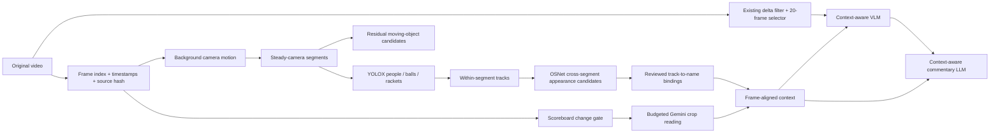

# Broadcast tracking, player context and score context

The new stage reads **original, unfiltered video** before the existing delta filter.
It does not replace the event selector or retrain either Gemini model. Person IDs
and observed scores are now optional, explicit inputs to both inference stages.



## Components

| Module | Responsibility | Main controls |
|---|---|---|
| `src/sports_events/frame_identity.py` | Counts original decoded frames; records decoder presentation timestamps, fallback basis and pixel hashes. | Zero-based `[start,end)` ranges; never approximate clip seeks. |
| `src/sports_events/broadcast_tracking.py` | Segments camera motion, runs local detector, tracks objects, proposes cross-shot links, writes box video. | `TrackingConfig`, detector interval, stable-motion limits, association threshold/margin, channel scoreboard crop. |
| `src/sports_events/broadcast_context.py` | Reads score crops, validates reviewed identities and builds context keyed by original frame. | VLM model/project, maximum calls, crop change gate, score freshness, bindings. |
| `src/sports_events/selector_vlm.py` | Adds context to twenty-frame event inference; suppresses names absent from confirmed visible bindings. | `--context`, `--context-only`. |
| `src/sports_events/end_to_end_eval.py` | Passes observed score and confirmed player context to the commentary model. | `--context`, separate `--vlm-run` and `--run`. |

Original frame numbers remain separate from delta-filtered indices. Original
timestamps and indices must match the selected window. Context includes original
image dimensions so bounding boxes can be interpreted correctly. Score lookup is
causal: no observation after the event anchor is used. Whole-window actor evidence
is still offline, as in the existing twenty-frame selector.

## Models and why

- **YOLOX-S**, COCO pretrained: local person, sports-ball and tennis-racket boxes.
  Uses OpenCV DNN and a checksum-pinned ONNX checkpoint; no per-frame cloud calls.
  [OpenCV model](https://github.com/opencv/opencv_zoo/tree/main/models/object_detection_yolox),
  [YOLOX paper](https://arxiv.org/abs/2107.08430).
- **OSNet x0.25**, MSMT17 pretrained: compact full-body appearance descriptors for
  person re-identification. Combined with clothing-color histograms. It is not a
  face recognizer and does not produce player names. This checkpoint was trained
  on pedestrians, not this tennis video; scores are not calibrated probabilities.
  [Author's model zoo](https://kaiyangzhou.github.io/deep-person-reid/MODEL_ZOO),
  [author's weights](https://huggingface.co/kaiyangzhou/osnet),
  [paper](https://arxiv.org/abs/1905.00953).
- **Gemini**, optional: transcribes small scoreboard crops into literal row
  labels, sets, games, points and a serving-row marker. A country code remains a
  country code. Existing tuned VLM/LLM endpoints consume the resulting context;
  they have **not** been retuned for the new fields.

OSNet architecture source is vendored in `src/sports_events/vendor/osnet.py` under
the upstream MIT license, included as `OSNET_LICENSE.txt`. Download helpers were
removed; checkpoint loading is strict, checksum-verified and `weights_only=True`.

Camera stability uses distributed corner tracking plus a RANSAC partial affine
transform. It measures translation, zoom and rotation, including accumulated
half-second drift. Low-texture/low-consensus frames are `unknown`, not assumed
stable. Short stable stretches are rejected. This is a threshold-based estimate,
not a guarantee of absolutely zero camera movement.

## Run locally

Run commands from `sports-event-selector/` after installing the package and
configuring Vertex authentication if score OCR is wanted.

```powershell
python -m pip install -e ".[vertex,dev]"
python tools/download_tracking_models.py
python -m sports_events.broadcast_tracking --video data/tenniset/videos/V010.mp4 --start-frame 16250 --end-frame 17250 --output runs/my_tracking
python -m sports_events.broadcast_context read-score --tracking runs/my_tracking --model gemini-3.1-flash-lite --project YOUR_PROJECT --max-calls 4
python -m sports_events.broadcast_context build --tracking runs/my_tracking --video-id V010
```

Omit start/end to process the complete unfiltered video. The default scoreboard
rectangle is a preset for this V010 broadcast only. Set `--scoreboard x1 y1 x2 y2`
with normalized coordinates for a different channel. It is not automatic scoreboard
localization. Use a fresh tracking output directory for each run.

Tracking uses no VLM. The score gate looks at compact text masks on every original
frame, invalidates prior context immediately when the display changes, waits for
a settled crop, and enforces a minimum request interval. Crops that remain visually
unchanged can reuse the earlier reading. A hard `--max-calls` budget includes
cached selected requests; excess changes become unknown. Responses are cached by
model, prompt and crop hash. There are no automatic paid retries. Visual change
detection and OCR can still fail; unreadable, stale or budget-exhausted states do
not become guessed scores. A displayed score is not a confirmed point outcome.

## Identify players without silently swapping names

`tracks.json` records anonymous local tracks and reference crops.
`associations.json` contains mutual best appearance links passing a threshold and
an ambiguity margin across every pair of stable segments. These are proposals:
**they do not automatically propagate names**. Each shot starts fresh local IDs.

`identity-bindings.template.json` is generated when context is built. To establish
names, copy it, fill only supported entries, set `reviewed: true`, and record the
evidence (for example, an explicit lineup plus serving-side evidence, a labeled
jersey, or a verified source annotation). Remove unreviewed entries from the
submitted `bindings` list. Do not treat country, court end or appearance alone as
proof of a player's name. Both original video and tracking-report hashes must match.

```json
{
  "source_sha256": "<original video SHA256>",
  "tracking_report_sha256": "<report.json SHA256>",
  "bindings": [
    {"track_id": "track_00000", "name": "Verified player name",
     "reviewed": true, "evidence": "Explicit identity evidence and original frame"}
  ]
}
```

```powershell
python -m sports_events.broadcast_context build --tracking runs/my_tracking --video-id V010 --bindings reviewed-bindings.json
python -m sports_events.selector_vlm evaluate --dataset data/tenniset_selector_vlm --model projects/214431161041/locations/us/endpoints/4910225415601127424 --project gen-lang-client-0084130013 --location us --context runs/my_tracking/context.json --context-only --output runs/context_vlm
python -m sports_events.end_to_end_eval --stage pipeline --context runs/my_tracking/context.json --context-only --vlm-run runs/context_vlm --run runs/context_commentary
```

`--context-only` explicitly limits inference to test windows fully covered by the
context file. Without it, incomplete coverage is an error. The same coverage and
context hash must be present in refreshed VLM predictions before LLM calls start.
Old named player-reference images are omitted from context-enabled VLM prompts.
Unknown actors stay unknown; legacy cached guesses cannot be silently reused.
No target event labels enter either generation prompt. Context-aware partial runs
are kept separate from the frozen original end-to-end benchmark.

## Outputs and limitations

- `annotated.mp4`: green moving detection boxes, gray other detections, yellow
  residual moving-object candidates, original frame numbers and camera status.
- `frames.jsonl`: original-frame identities, camera transforms, stable segment ID,
  detector boxes and held-box ages. Between detector calls, boxes are held for up
  to `detect_every - 1` frames; these are explicitly approximate.
- `tracks.json`, `crops/`, `associations.json`: inspectable appearance evidence.
- `score-candidates.json`, `scores.json`, `score-usage.json`: crop selection, actual
  OCR observations and call budget. Score calls have token usage and timings.
- `context.json`: score timeline and frame-level person context for both models.
- `report.json`: source/model hashes, configuration and measured run statistics.

Officials and spectators are people too; the detector does not certify who is an
active player. Motion blobs may be shadows/noise, not tennis balls. Tiny fast balls
may be missed by YOLOX. Uniform changes, similar outfits, occlusions and camera
angles can break association. Association grows with the number of segment pairs;
long matches will benefit from an indexed appearance gallery. Camera pans and
unknown camera states deliberately have no active tracking boxes in this version.
The selector still processes its original delta-filtered feed independently.

The tests cover camera motion vs local object motion, exact source frame indices,
unknown camera states, one-to-one local tracking, ambiguous appearance rejection,
score invalidation/freshness, context mismatch and passing scores to the LLM.
Run `python -m pytest tests/test_broadcast_tracking.py -q`.

## Recorded pilot

The completed test used original V010 frames **16250–17249** (40 seconds), not a
delta-filtered export. It found three stable segments containing 231 frames,
made 48 local detector calls, and proposed 14 cross-segment appearance links.
Processing took 31.7 seconds on this machine, including source decoding and video
writing. It is not a full-match throughput benchmark. Visual inspection supports
the near-player link across all three segments; some other detections are staff
or false positives, so these counts are not accuracy metrics.

Seven small scoreboard crops were selected: four readable observations and three
unreadable crops. They captured 15–0 changing to 15–15. Selected score calls used
8,708 input and 600 output tokens (about $0.0031 at the recorded pricing assumptions,
excluding earlier development attempts and event/commentary model calls).

Six existing DL windows were then run through the tuned VLM and LLM with this
context. All six requests carried the observed score. No player bindings were
confirmed for this test, so all six names remained unknown and commentary used
"the player". Exact event accuracy on this small subset was **0%**, because it
withheld names and did not recover all annotated shot details. This validates the
integration and abstention behavior, not an improvement in named-event accuracy.
Next: verify track/name bindings, evaluate player swaps on labeled cross-camera
sequences, calibrate motion/association thresholds, and retune with the new context.

Machine-readable evidence: `docs/broadcast-tracking-pilot.json`. Local video and
appearance contact sheet: `runs/broadcast_tracking_v4/annotated.mp4` and
`runs/broadcast_tracking_v4/association-review.jpg`. These media and model weights
stay outside Git; the code, tests and compact report are versioned.
