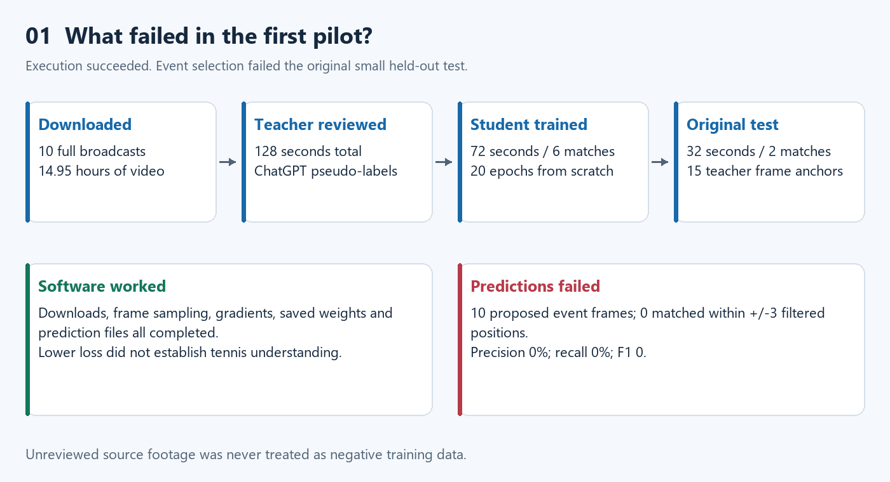
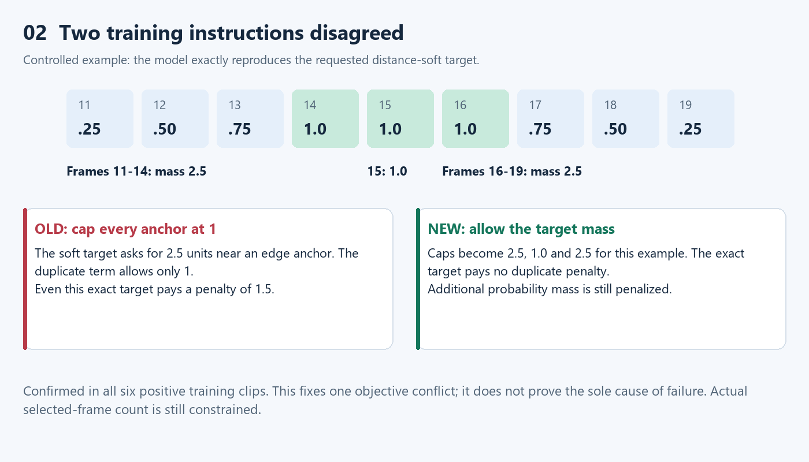
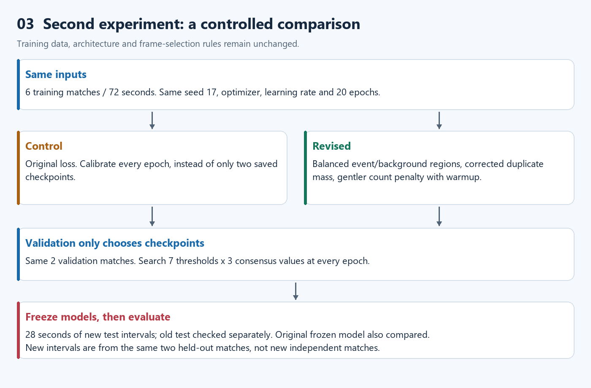
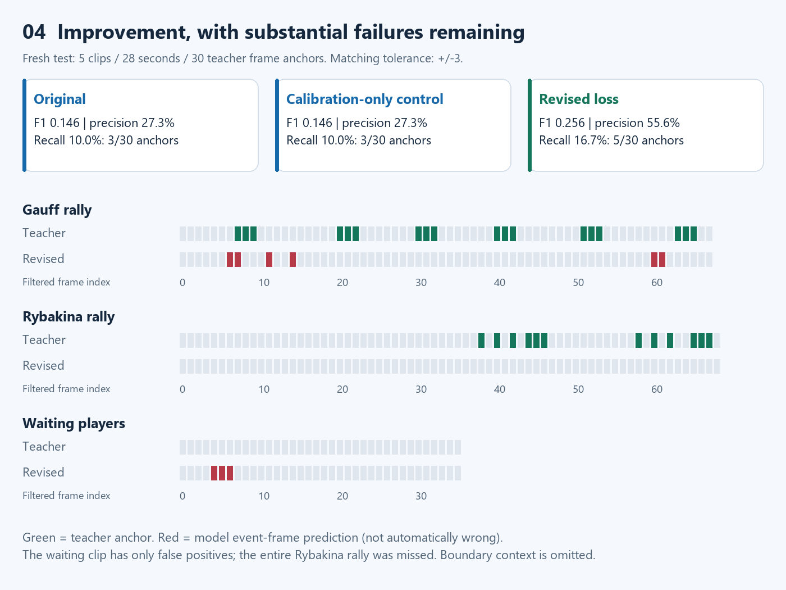

# Why the first pilot failed, what changed, and experiment 2

The second experiment completed. It improved the measured frame-selection results, but **the model is still not a reliable tennis event detector**. On 28 seconds of newly reviewed test footage, the revised model matched 5 of 30 teacher frames, compared with 3 for the original model. Its F1 increased from 0.146 to 0.256; recall remains only 16.7%.

## 1. What “failed pilot” means

“Pilot” means a small end-to-end feasibility experiment. The engineering pipeline ran: it downloaded videos, sampled frames, accepted teacher annotations, backpropagated gradients, saved weights, and produced event-frame arrays. “Failed” refers to the **usefulness of those predictions on the first test**, not a crash or missing training run.

The first test contained five clips from two matches, with five teacher events represented by 15 frame anchors. The model proposed 10 event frames, but none lay within three filtered-frame positions of a matchable teacher anchor. Thus precision, recall and F1 were all zero. The four mandatory boundary frames per clip were saved separately and were not counted as event detections.

Precision asks “how many selected event frames were relevant?” Recall asks “how many teacher event frames did we recover?” F1 balances both. Matching is one-to-one: selecting several nearby frames cannot repeatedly claim the same teacher frame. The tolerance is ±3 **filtered frame indices**, not ±3 seconds. At 8.33 FPS it is roughly 0.36 seconds, but varies with sampling.



The original model's training loss fell from 5.194 to 0.391. That alone was not success: loss combines several competing goals, and a model can lower it by becoming reluctant to select frames. A saved checkpoint and passing software tests establish execution, not tennis understanding. Zero on this tiny test also does not prove zero ability on every video: the unchanged original model scored 0.146 on the fresh clips in experiment 2.

## 2. Evidence versus hypotheses

| Finding | Evidence | Interpretation |
|---|---|---|
| Tiny supervision set | 72 seconds / 691 frames / 25 events actually trained the model | Insufficient coverage is a plausible contributor, not an isolated causal finding |
| Conflicting duplicate penalty | Feeding the exact distance-soft target into the old loss gives duplicate penalties of 0.729–2.378 across all six positive training clips | A confirmed objective conflict, not proof it alone caused zero F1 |
| Large early excess penalty | First epoch: 4.411 of 5.194 total loss came from weighted excess count, about 84.9% | Suppression pressure was large in loss units; this percentage is not a measurement of gradient influence |
| Checkpoint-selection mismatch | Original training ranked epochs at threshold 0.5; only the saved best and last checkpoints were calibrated later | An epoch good at another threshold could be discarded |
| Sparse global budget | Training-derived optional-frame rate is 0.11664; a 68-frame clip gets only seven optional frames | Dense rallies cannot retain all teacher anchors under that cap |
| Weak visual representation | Scratch CNN, 96×96 scene input, global spatial pooling, no explicit motion stream | May lose small racket/ball/body-motion cues; not tested by the loss-only revision |
| Imperfect teaching | ChatGPT contact-sheet judgments, approximate timing, no independent human review | Scores measure agreement with these pseudo-labels, not verified sporting truth |

The whole source corpus is 14.95 hours, but the first run reviewed only 128 seconds and trained on 72 seconds. Download volume must not be confused with labeled training volume. The same 72 seconds are used again here deliberately, to compare optimization changes without also changing the training data.

## 3. The concrete loss conflict

Suppose an event uses true frames 14, 15 and 16. The requested distance targets around them are:

```text
Frame:          11   12   13   14   15   16   17   18   19
Target:        .25  .50  .75  1.0  1.0  1.0  .75  .50  .25
Nearest true:   14   14   14   14   15   16   16   16   16
Target mass:   [------ 2.50 -----] 1.0 [------ 2.50 -----]
```

The original duplicate term allowed probability mass of only 1 per true frame. Even a perfect reproduction of this target therefore paid a penalty: `((2.5−1)² + 0 + (2.5−1)²) / 3 = 1.5`. One objective asks for the soft neighborhood; another pushes it down.



The revised duplicate term permits the mass already requested by the distance target for each nearest-anchor region: 2.5, 1, and 2.5 in this example. Additional mass is still penalized. The six-positive window cap and global selection penalty still constrain actual output counts. This fixes this specific contradiction; it does **not** remove all tension between tolerant relevance scores and a sparse final output.

## 4. Exactly what changed

| Component | First pilot | Revised run |
|---|---|---|
| Relevance loss | Every global frame equally weighted | Event neighborhoods and background each contribute half of relevance loss when both exist; distance targets remain unchanged |
| Negative-only clips | Background learning | Still background learning, never ignored |
| Duplicate mass | Cap 1 per nearest teacher anchor | Cap equals assigned distance-target mass |
| Excess-count weight | 0.5 from the first update | 0 at epoch 1; 0.04, 0.08, 0.12, 0.16, then 0.20 from epoch 6 |
| Count normalization | Divide by actual budget, minimum 1 | Divide by budget, minimum 10, so four-boundary-frame negatives do not create such a steep scale |
| Model selection | Fixed-threshold per-clip-average F1, then late calibration of two checkpoints | Calibrate every epoch using validation micro F1, counting false positives on negative clips |

The actual uncapped post-filter selection count remains in the forward loss. Gradients through discrete selection still use a straight-through approximation, not exact differentiation. Training still computes this term at threshold/consensus 0.5/0.5, while validation may choose different inference values; that mismatch remains a limitation. The inference budget still comes only from training labels; no test labels determine how many frames are selected.

The architecture, image sizes, scoreboard branch, 10-frame window, stride one, top-six cap, three-window support, mandatory endpoints, sequence grouping, training labels, seed, optimizer and learning rate stayed the same. Sampling also stayed unchanged: its low-motion rate can fall below 10 FPS due to quantization. Fixing sampling would require regenerated frames and reannotation, so it was not silently changed for this comparison.

## 5. How the second test was kept separate



Two 20-epoch training runs used the same six training matches and two validation matches:

1. **Control:** original loss, but calibrate every epoch.
2. **Revised:** revised loss and the same epoch calibration.

Both searched the same seven thresholds (0.1–0.7) and three overlap-consensus values (0.5, 0.65, 0.8). No test clips entered optimization or checkpoint/threshold selection. The original frozen checkpoint was also evaluated for comparison. All training and model selection completed before the test predictions were evaluated. The protocol and teacher-label fingerprint were saved before training.

The fresh test contains five new intervals, 254 retained frames, and 10 approximate teacher events / 30 anchors:

| Match | Broadcast interval | Reviewed content |
|---|---|---|
| Rybakina–Mertens | 908–916 s | Serve and rally |
| Rybakina–Mertens | 926–930 s | Spectators |
| Gauff–Danilovic | 922–930 s | Serve and rally |
| Gauff–Danilovic | 940–944 s | Player close-ups |
| Gauff–Danilovic | 914–918 s | Waiting players, court visible |

These are **new intervals from the same two previously held-out matches**, not a new independently sampled set of matches. They were chosen through visual scouting, reviewed before training, and never used for model selection. This is a useful follow-up check but still vulnerable to small-sample and scene-selection bias. The old test is reported separately as a regression check, not fresh evidence.

## 6. Measured results

All values below use ±3 filtered-frame, one-to-one matching. The model changes were not retuned after seeing these results.

| Fresh test | Selected event frames | Matches / 30 | Precision | Recall | F1 |
|---|---:|---:|---:|---:|---:|
| Original checkpoint | 11 | 3 | 27.3% | 10.0% | 0.146 |
| Control: calibration change only | 11 | 3 | 27.3% | 10.0% | 0.146 |
| Revised loss + calibration | 9 | 5 | **55.6%** | **16.7%** | **0.256** |
| Periodic triplet baseline | 25 | 4 | 16.0% | 13.3% | 0.145 |

The revised model retained 29/254 total frames (11.42%), including 20 mandatory boundary frames. The cap is the same across methods; actual output sizes differ because it is a maximum, not a quota.

The revised checkpoint came from **epoch 4**, threshold **0.4**, consensus **0.65**, with validation F1 **0.286**. The control chose epoch 5, threshold 0.2, consensus 0.65, validation F1 0.172. The original checkpoint had validation F1 0.169.

On the **old test**, F1 was 0.000 original, 0.000 control, and **0.364 revised**. The revised model matched 4/15 teacher frames with seven event-frame predictions. That improvement is encouraging, but the fresh-test result is the more relevant follow-up evidence.



The fresh-test timeline makes the remaining problems visible:

- The revised model selected `[6,7]`, `[11,14]`, and `[60,61]` in the Gauff rally. Five of those six frames matched teacher anchors within tolerance; one did not.
- It selected `[4,5,6]` in the waiting-player clip: **three false positives**.
- It selected **no events in the Rybakina rally**, missing all 12 teacher anchors there.
- It returned no event proposals on the two off-court clips.

These are frame-level results. A group containing a nearby correct frame and an irrelevant frame is not necessarily a coherent event sequence. We have not established caption quality, event-class accuracy, successful score reading, or reliable whole-match behavior.

## 7. What the result does and does not establish

The revised package improved both recorded tests in this seed and sample. The unchanged fresh-test score of the calibration-only control makes it unlikely that the observed gain came solely from the checkpoint-selection change. However, the revised run bundles neighborhood weighting, duplicate-mass correction and gentler count penalties. It does not isolate the contribution of each, and a single seed cannot establish statistical reliability.

Recall is still low. The global budget itself caps the two original validation action clips at 14 optional frames against 45 teacher anchors, a 31.1% frame-recall ceiling even before ranking mistakes. Increasing that budget blindly would raise false positives, especially on waiting scenes. A later experiment should learn event density from visual evidence and evaluate that separately, while retaining the requested excess-frame penalty.

Other unresolved work is broader audited training coverage, independent label checks, a stronger spatial/motion representation, sampler timing, and evaluation on additional untouched matches. None is claimed as already solved. This is an improved research baseline, not a deployed or production-ready model.

## 8. Artifacts and reproduction

- [Protocol](second-results/protocol.json): frozen candidate grid and split membership.
- [Diagnostics](second-results/diagnostics.json): exact-target loss probe and original loss components.
- [Comparison](second-results/comparison.json): all measured tolerance scores, including exact-frame matching.
- `runs/tennis_second/v2/best.pt`: revised model; the original checkpoint is preserved.
- `runs/tennis_second/v1/best.pt`: calibration-only control.
- `runs/tennis_second/{v1,v2}/history.json`: all 20 epochs and every validation candidate.
- `runs/tennis_second/fresh_test/`: predictions and per-clip metrics for all three models.
- `examples/tennis_second_teacher.json`: teacher labels and limitations.
- `data/tennis_second/review/`: every reviewed test frame as contact sheets.

From a Python installation with this repository's dependencies:

```powershell
python -m sports_events.broadcasts review --inventory data/tennis_broadcasts/inventory.json --selections examples/tennis_second_selections.json --output data/tennis_second
python -m sports_events.experiment2 --output runs/tennis_second_repeat --epochs 20
```

The previous pilot data and original checkpoint must exist for the comparison. **39 tests passed**, including new tests demonstrating the old duplicate conflict, the revised correction, continued negative-clip penalties, and exclusion of test records from calibration. Passing tests verify these mechanics, not prediction accuracy.
