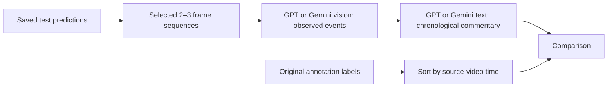

# TenniSet: selected frames to timestamped commentary

Implementation: `src/sports_events/commentary.py`. No retraining or changes to
the selected checkpoint. The scope is the existing test excerpts of one video,
not full-match inference. Output is timestamped text, not synthesized video/audio.



The two providers can be chosen independently. The vision stage receives only
selected images, never annotation labels. The text stage receives all ordered
observations together, including uncertain observations and clip boundaries.
It must retain every observation exactly once. Code assigns timestamps from
the original-video metadata; models cannot invent or reorder timestamps.
First/last context frames are not silently treated as event predictions.
Disconnected excerpts must not be narrated as a continuous rally.

## Use

From the repository root:

```powershell
python -m sports_events.commentary prepare --video V010
```

Configure `OPENAI_API_KEY` and/or `GEMINI_API_KEY` (`GOOGLE_API_KEY` is accepted)
locally. ChatGPT subscription/sign-in credentials are not reused as API keys.
Choose available model IDs in your provider account and set `VLM_MODEL` and
`LLM_MODEL` in your environment. Both stages require explicit model IDs.

```powershell
# GPT vision + GPT commentary
python -m sports_events.commentary run --video V010 --vlm-provider gpt --vlm-model $env:VLM_MODEL --llm-provider gpt --llm-model $env:LLM_MODEL --output runs/tenniset_commentary/gpt_V010

# Gemini vision + Gemini commentary
python -m sports_events.commentary run --video V010 --vlm-provider gemini --vlm-model $env:VLM_MODEL --llm-provider gemini --llm-model $env:LLM_MODEL --output runs/tenniset_commentary/gemini_V010
```

Mixed providers also work. Use distinct output folders for experiments.
Requests upload only selected JPEGs and event descriptions, not the full video.
Responses are cached by provider, model, prompt and image content; retries handle
rate limits and transient server errors. Call receipts record returned model ID,
token usage and elapsed time when provided. Credentials are never saved.
Malformed or incomplete responses fail rather than silently becoming events.

Provider implementation uses [OpenAI Responses](https://developers.openai.com/api/reference/resources/responses/methods/create)
and [Gemini generateContent](https://ai.google.dev/api/generate-content).

## Files

Under the chosen output directory:

| File | Meaning |
| --- | --- |
| `input.json` | Selected frames, source indices/times, image hashes, test clip scope |
| `observations.json` | Vision descriptions, serve/hit/uncertain/no_event, subjective confidence |
| `commentary.json`, `commentary.txt` | Ordered commentary with provenance and original-video times |
| `reference.json`, `reference-commentary.txt` | All original-label events in the same test excerpts, simply ordered |
| `comparison.json`, `comparison.md` | Event matching diagnostics and generated/reference text comparison |
| `calls/*.json` | API receipts, generated only during actual API runs |

The reference uses original event text and mapped representative-frame timestamps,
not an assertion that these are exact human-marked contact times. Player names
and spin labels in the reference are not supplied to the vision model.

## Completed ChatGPT-assisted run: V010

At the user's request, this conversation inspected the actual selected images
and composed commentary directly. **No authenticated GPT or Gemini API calls
were made.** The API routes are covered by mocked transport tests, not live API
verification. No API model ID or token count is claimed for this chat review.
Earlier conversation included some labels, so this is not a blind evaluation.

The artifacts are in `runs/tenniset_commentary/V010`:

- 24 test excerpts, totaling 192 seconds, from V010; 21 excerpts had no proposals.
- 7 model-selected sequences / 15 images, located in 3 excerpts.
- 24 original-label events in the same test excerpts.
- 2 visually supported stroke observations; 5 uncertain observations.
- 4/24 reference events could be matched to selected sequences temporally,
  ignoring vision classification (one-to-one).
- 2/24 reference events matched confident vision descriptions by time and broad
  serve/hit class: 8.3% coverage, with 2/2 confident descriptions matching.

These are event-sequence diagnostics, not the earlier frame-anchor precision and
recall. A match uses the same clip, minimum distance between target and prediction
anchors of at most 3 filtered indices, and matching broad class. Maximum-cardinality
one-to-one matching prevents multiple fragments receiving credit for one event.
The 2/2 result is tiny and does not establish 100% caption accuracy: it does not
test player identity, shot detail, or fluent-prose factuality.

Example at 00:11:01: generated commentary describes a near-baseline swing;
the original label is "Azarenka hits a forehand topspin shot." The selected
images support less detail than the original annotation. The reference also
contains entire rallies at 00:22 and 00:52 absent from the model output.
Chronological writing cannot recover these missing events from no evidence.

To replay the saved conversational review (no network calls):

```powershell
python -m sports_events.commentary import-review --output runs/tenniset_commentary/V010 --review runs/tenniset_commentary/V010/chatgpt-review.json
```

For a new dataset, first run `prepare`; imported reviews must match its exact
fingerprint and images. This route is explicitly marked `chatgpt-assisted-review`.

## Alter and improve

- Change `VISION_PROMPT` to adjust the permitted visual claims. Preserve an
  uncertainty option; do not force every proposal to be a true event.
- Change `sequence_prompt` for narration style; keep source IDs, ordering and
  uncertainty requirements. Structural checks cannot prove semantic faithfulness.
- Point `--dataset` and `--predictions` at a new test split with the same schemas.
- Improve selector recall and grouping before expanding commentary claims. Consider
  a separately measured experiment supplying short temporal context around proposals;
  it would add input images and must be distinguished from this selected-only run.
- Use a fresh, independently reviewed test and actual API calls before comparing
  provider quality. This conversational example is exploratory, not a provider benchmark.

Tests: `python -m pytest tests/test_commentary.py -q` checks label separation,
one-to-one scoring, ordered coverage, and both API payload/cache paths.
